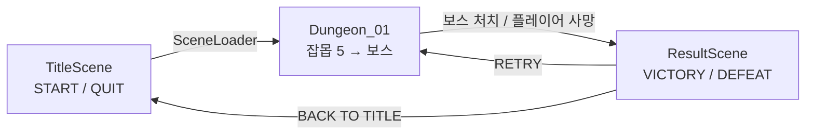
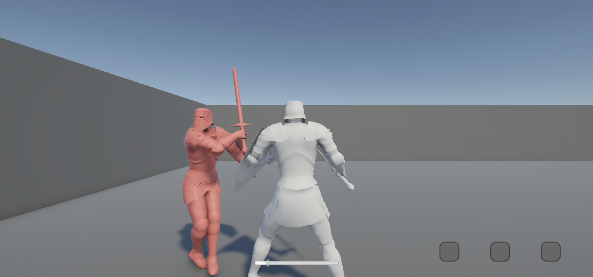
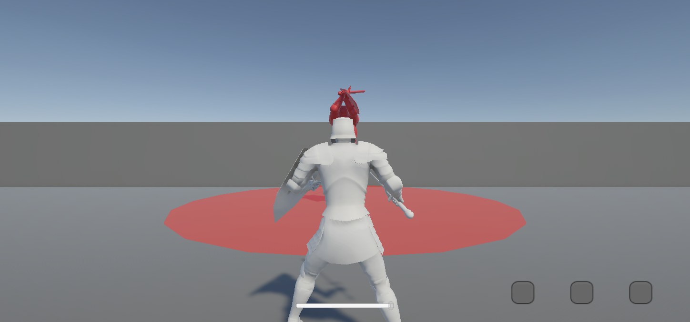
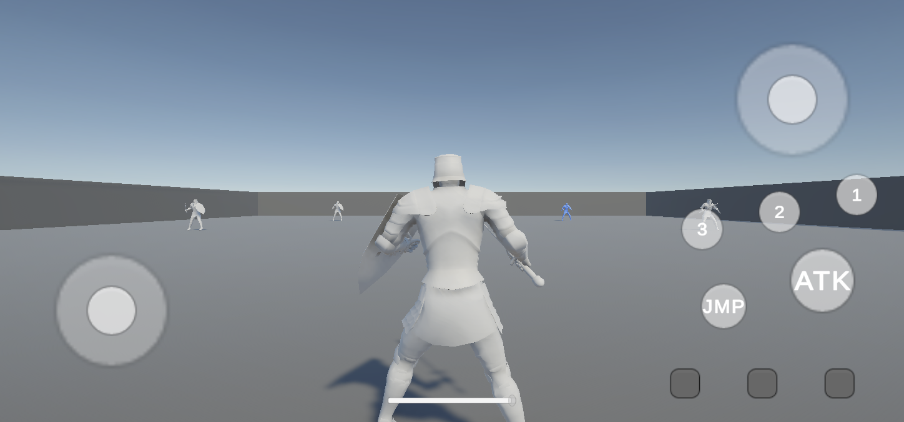
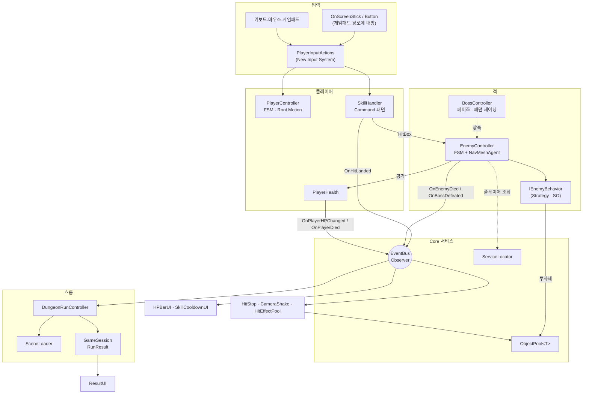

# ⚔️ Unity Action RPG

> 3인칭 싱글 액션 RPG — 던전을 돌파해 보스를 처치하면 클리어  
> Unity 6 · URP · C# · UniTask · Cinemachine · New Input System

잡몹 5마리를 지나 2페이즈 보스를 처치하면 클리어되는 **타이틀 → 던전 → 결과** 한 판짜리 루프가 완성되어 있다.
설계 판단과 측정 수치는 구현만큼 중요하게 다뤄서 [`docs/decisions.md`](docs/decisions.md), [`docs/measurements.md`](docs/measurements.md)에 따로 기록한다.

---

## 📌 프로젝트 개요

| 항목 | 내용 |
|---|---|
| 장르 | 3인칭 액션 RPG (TPS 시점) |
| 엔진 | Unity 6000.3.13f1, URP |
| 개발 기간 | - |
| 개발 규모 | 1인 개발 |
| 플랫폼 | PC (키보드·마우스·게임패드), 모바일 터치(온스크린 스틱) |

### 한 판의 흐름



### 스크린샷

| 적 공격 선딜 경고 | 보스 충격파 선딜 | 모바일 온스크린 컨트롤 |
|---|---|---|
|  |  |  |

---

## 🏗️ 아키텍처



```
Assets/Scripts/
├── Core/     GameManager(Singleton 1개), EventBus, ServiceLocator, ObjectPool, HitStop/CameraShake
├── Player/   PlayerController(FSM), PlayerHealth, AnimatorMoveRelay(Root Motion)
├── Combat/   Command 패턴 스킬, SkillHandler, HitBox, HitEffectPool
├── Enemy/    EnemyController(FSM), Behaviors/(Strategy SO), Boss/, ProjectilePool, EnemyTelegraph
├── Flow/     SceneLoader, GameSession, RunResult, DungeonRunController, SceneNames
├── UI/       HPBarUI, SkillCooldownUI, TitleUI, ResultUI, MobileControlsUI, SafeAreaFitter
├── Data/     CharacterStatData, EnemyAIData (ScriptableObject)
└── Debug/    EnemyDetectionBenchmark, PoolBenchmark (에디터/개발 빌드 전용)
```

### 사용한 디자인 패턴

| 패턴 | 적용 위치 | 이유 |
|---|---|---|
| Singleton | `GameManager` (1개) | 전역 접근이 꼭 필요한 최소 시스템만 제한 적용 |
| Service Locator | `SceneLoader`, `GameSession`, `PlayerHealth`, 이펙트/투사체 풀 | Singleton 남용 방지, 씬 소속 서비스는 `OnDestroy`에서 해제 |
| Observer (EventBus) | HP 변경, 사망, 히트, 보스 페이즈/처치, 쿨타임 | 컴포넌트 간 직접 참조 제거 |
| Command | 기본공격, 스킬 1~3 | 스킬 추가 시 기존 코드 수정 최소화 |
| State (FSM) | 플레이어, 적 AI, 보스 | 상태별 행동을 분리, 보스는 적 FSM을 상속해 재사용 |
| Strategy | 적 공격 행동 (근접/원거리/범위/보스 패턴) | SO로 주입해 코드 수정 없이 적 종류 교체 |
| Template Method | `EnemyBehaviorData` | 선딜 → 타격 → 후딜 골격을 고정하고 `Strike()`만 구현체가 정의 |
| Object Pool | 히트 이펙트, 적 투사체 | `Instantiate/Destroy` 제거 |
| Data-driven (ScriptableObject) | 스탯, 적 AI 수치, 행동, 보스 페이즈 | 수치를 코드에서 분리 |

---

## 🧩 패턴별 "문제 → 선택 → 결과"

### Command — 스킬 시스템

- **문제:** 스킬이 늘 때마다 입력 처리 코드에 분기가 늘고, 쿨타임·사용 조건이 한 곳에 뒤섞인다.
- **선택:** `ISkillCommand`(`Execute` / `CanExecute` / `Dispose`)로 스킬을 객체로 만들고 `SkillHandler`가 실행만 관리한다. 쿨타임은 `UniTask.Delay` + `CancellationToken`.
- **결과:** 기본공격과 스킬 1~3이 각자의 클래스로 분리됐고, 쿨타임 UI는 `EventBus`로만 갱신된다.
- **한계:** 스킬 1~3은 아직 같은 공격 트리거를 쓰고 효과가 서로 다르지 않다(공격력 배율도 데미지에 적용되지 않음). 콤보 이벤트(`OnComboTriggered`)는 발행만 되고 구독하는 곳이 없다.

### Strategy + Template Method — 적 공격 행동

- **문제:** 적 종류마다 공격 방식이 다르고, 공격 타이밍이 하드코딩되면 종류가 늘 때마다 FSM을 고쳐야 한다. 이후 패링을 붙이려면 "반응할 수 있는 구간"이 있어야 한다.
- **선택:** `IEnemyBehavior`를 `ScriptableObject`(`EnemyBehaviorData`)로 구현하고, 선딜 → 타격 → 후딜 골격은 베이스 클래스가 고정한다. 적 FSM의 `Attack` 상태는 이 인터페이스만 호출한다.
  선딜 시간은 Mixamo 클립에서 손 속도가 최대인 시점을 샘플링해 정했다.
- **결과:** 프리팹에서 SO만 바꾸면 근접/원거리/범위/보스 패턴이 바뀐다 — Play 모드에서 근접 적에게 원거리 SO를 런타임 주입해 동작이 바뀌는 것을 확인했다.
  타격 순간에 상태를 다시 판정하므로 선딜 중 물러나면 빗나가고(HP 불변 확인), 선딜 중 맞으면 공격이 중단된다. `AttackPhase` / `AttackPhaseChanged`로 선딜 구간이 외부에 노출되어 있어 패링 판정은 이 구간에 붙이면 된다.

### FSM — 플레이어, 적, 보스

- **문제:** 순찰·추격·공격·피격·사망이 한 `Update`에 섞이면 상태 전이를 추적할 수 없다.
- **선택:** `switch` 기반 FSM. 적은 `Idle / Patrol / Chase / Attack / Hit / Dead`이고 탐지·추격 포기·공격 범위는 SO에서 주입한다. 보스는 `EnemyController`를 상속해 공격(`RunBehaviorAsync`)·공격 범위·이동 속도만 `virtual` 확장 지점으로 바꾼다.
- **결과:** 보스 전용 상태 머신을 따로 만들지 않고 순찰/추격/사망 처리를 그대로 재사용했다. 페이즈는 `BossData` SO(HP 임계값, 패턴 목록, 간격, 이동 속도 배율)로 정의된다.
- **한계:** 상태를 클래스로 분리하지 않은 `switch` 구조다. 상태가 더 늘면 State 클래스 분리가 필요하다.

### EventBus + ServiceLocator — 결합도와 씬 수명

- **문제:** 컴포넌트가 서로를 직접 참조하면 씬이 바뀔 때 죽은 참조가 남고, 전역 접근을 Singleton으로만 풀면 의존성이 숨는다.
- **선택:** 정적 `EventBus`로 통신하고(`OnEnable` 구독 / `OnDisable` 해제), 서비스는 `ServiceLocator`로 조회한다. **씬 소속 서비스는 `Awake`에서 등록·`OnDestroy`에서 해제**하고, 씬을 넘어 유지되는 서비스(`SceneLoader`, `GameSession`)는 앱 시작 직전에 한 번만 등록한다.
- **결과:** 타이틀 → 던전 → 결과를 4회 진입하며 구독 수·서비스 등록·Singleton 개수·`timeScale`을 점검했고 누수가 없었다(히트스탑 도중 전환 포함).
  이 검증에서 **`DontDestroyOnLoad` 오브젝트에 붙어 있던 씬 종속 매니저가 재진입 후 파괴된 참조로 예외를 내는 버그**를 찾아, 씬 소속 오브젝트로 분리했다.

### Object Pool — 히트 이펙트와 투사체

- **문제:** 히트마다 `Instantiate/Destroy`를 하면 스폰 CPU와 GC 할당이 쌓인다.
- **선택:** 제네릭 `ObjectPool<T>`를 만들어 이펙트(`HitEffectPool`)와 투사체(`ProjectilePool`)에 적용했다.
- **결과:** 아래 [측정 결과](#-측정-결과)의 수치 참고 — 스폰/반환 CPU가 히트 이펙트 −90%, 투사체 −44%.

---

## 📊 측정 결과

모든 수치는 **Unity Editor Play 모드**에서 잰 값이다. 방법·한계·원자료는 [`docs/measurements.md`](docs/measurements.md)와 `docs/data/`에 있다.
**실기기(모바일) 수치는 아직 없다.**

### 병목 1건 — 적 수에 비례하는 드로우콜

적 0 / 50 / 100마리에서 Profiler 마커 약 2,300개를 비교해, 적이 늘 때 가장 크게 늘어나는 항목을 골랐다. 탐지(0.06 ms)가 아니라 **렌더링(드로우콜)** 이었다.
적 1마리당 스키닝 메시 4개(몸·투구·방패·검)가 약 16개의 드로우콜을 만들고 있었는데, 4개가 **같은 재질·같은 69개 본 배열**이라 하나로 병합했다.

| 적 100마리, 같은 세션에서 교대 측정(A-B-A-B) | Before (메시 4개) | After (메시 1개) | 변화 |
| --- | --- | --- | --- |
| 드로우콜 | 1,433 | **408** | **−72%** |
| 프레임 시간 | 8.07 ms | 6.82 ms | −15% |
| FPS | 124 | 147 | +18% |
| 그림자 패스 | 1.10 ms | 0.46 ms | −58% |

개선폭은 세션을 달리해 잰 첫 비교(+30%)보다 작지만, 세션 간 FPS가 ±수십 % 흔들리는 것을 확인해 교대 측정값을 대표로 썼다.

### Object Pool (4,800회 생성/제거, 교대 2회 평균)

| 대상 | 방식 | 스폰/반환 CPU (프레임당) | 프레임 시간 | 추가 GC 할당 |
| --- | --- | --- | --- | --- |
| HitEffect | Instantiate/Destroy | 1,290 µs | 8.83 ms | 약 5.3 MB |
| HitEffect | ObjectPool | **135 µs (−90%)** | 5.69 ms | ≈ 0 |
| EnemyProjectile | Instantiate/Destroy | 556 µs | 8.07 ms | 약 5.0 MB |
| EnemyProjectile | ObjectPool | **309 µs (−44%)** | 5.80 ms | ≈ 0 |

측정 구간에서 GC가 한 번도 발동하지 않아 "GC 횟수 감소"는 주장하지 않고 할당량 차이로만 말한다.

### 적 탐지 — QuadTree 미채택

병목 기준(30마리 0.5 ms / 100마리 2.0 ms)을 **측정 전에** 먼저 정해 두고 쟀다. 100마리에서 현재 방식(제곱거리 비교) 0.062 ms, `Physics.OverlapSphere` 방식 0.187 ms로
기준의 3% / 9%였다. **병목이 아니라서 QuadTree를 채택하지 않았다.** 다시 검토할 조건은 적이 수백~수천 마리가 되거나 적끼리 이웃 질의가 필요해지는 시점이다.

### 통합 검증

잡몹 5 + 보스를 플레이어의 실제 공격 경로로 처치하는 봇으로 전체 흐름을 검증했다(처치 6/6, 이벤트 누락·중복 없음). 이 과정에서 **플레이어의 공격이 적에게 한 번도 맞지 않던 버그**
(트리거 판정에 `Rigidbody`가 없어 `OnTriggerEnter`가 호출되지 않음)를 찾아 고쳤다 — 적에게 `TakeDamage`를 직접 부르는 테스트로는 드러나지 않았던 문제다.

---

## ⚙️ 주요 기술 구현

- **New Input System:** 키보드 + 게임패드 바인딩. 모바일 온스크린 스틱/버튼은 게임패드 경로(`<Gamepad>/leftStick` 등)에 매핑해 입력 처리 코드를 고치지 않고 동작한다
  (카메라 회전만 `Look` 액션에 `<Gamepad>/rightStick`을 추가).
- **UniTask:** 쿨타임, 공격 시퀀스(선딜 → 타격 → 후딜), 보스 패턴 체이닝, 결과 전환 딜레이. 모두 취소 토큰으로 사망/파괴 시 중단된다.
- **히트스탑 + 카메라 쉐이크:** `Time.timeScale` 순간 정지, Cinemachine Impulse. 보스 페이즈 전환은 더 길고 크게(이벤트로만 연결, 매니저는 보스를 모른다).
- **NavMesh AI:** `NavMeshAgent` 순찰·추격, 탐지·추격 포기 거리 히스테리시스, 공격 선딜 경고(모델 틴트 + 범위 공격 시 바닥 범위 원).
- **모바일 대응:** Canvas Scale With Screen Size(1920×1080), `SafeAreaFitter`, 가로 전용 고정, IL2CPP + .NET Standard 2.1 + ASTC.

---

## ▶️ 실행 방법

1. Unity **6000.3.13f1**으로 프로젝트를 연다 (UniTask는 git URL 패키지라 첫 임포트 때 인터넷이 필요하다).
2. `Assets/Scenes/TitleScene.unity`를 열고 Play. (어느 씬에서 시작해도 `SceneLoader`가 먼저 등록된다.)
3. Build Settings의 씬 순서는 `TitleScene → Dungeon_01 → ResultScene`.

| 조작 | PC | 게임패드 | 모바일 |
|---|---|---|---|
| 이동 | W A S D | 왼쪽 스틱 | 왼쪽 가상 스틱 |
| 카메라 | 마우스 | 오른쪽 스틱 | 오른쪽 가상 스틱 |
| 공격 | 마우스 왼쪽 | X(West) | ATK |
| 스킬 1 / 2 / 3 | E / Q / R | RB / RT / Y | 1 / 2 / 3 |
| 점프 | Space | A(South) | JMP |
| 달리기/걷기 | Ctrl | - | - |

벤치마크(`EnemyDetectionBenchmark`, `PoolBenchmark`)는 에디터/개발 빌드 전용이며 Play 모드에서 컴포넌트를 붙여 실행한다. 사용법은 각 파일 상단 주석과 `docs/measurements.md`를 본다.
`CLAUDE.md`에는 Unity CLI로 에디터를 제어하는 방법과 코드 규칙이 정리되어 있다.

---

## ✍️ 코딩 스타일 샘플

**Template Method + 취소 가능한 비동기 시퀀스** (`EnemyBehaviorData`) — 골격은 고정하고 구현체는 `Strike()`만 정의한다.

```csharp
public async UniTask ExecuteAsync(EnemyAttackContext context, CancellationToken token)
{
    // 선딜 — 예비 동작 + 경고 표시
    context.SetPhase(EnemyAttackPhase.Windup);
    context.PlayAnimation(animationTrigger);
    context.Telegraph?.Begin(windupTime, TelegraphRadius);
    await UniTask.Delay(ToMilliseconds(windupTime), cancellationToken: token);

    // 타격 — 이 시점의 상태로 판정하므로 선딜 중 물러나면 빗나간다
    context.Telegraph?.End();
    context.SetPhase(EnemyAttackPhase.Strike);
    Strike(context);

    // 후딜
    context.SetPhase(EnemyAttackPhase.Recovery);
    await UniTask.Delay(ToMilliseconds(recoveryTime), cancellationToken: token);
}

/// <summary>타격 순간의 동작 — 데미지 판정 또는 투사체 발사</summary>
protected abstract void Strike(EnemyAttackContext context);
```

**씬 소속 서비스의 수명 관리** (`ServiceLocator`) — 같은 인스턴스일 때만 해제해 재진입 시 죽은 참조를 막는다.

```csharp
public static void Unregister<T>(T service)
{
    if (_services.TryGetValue(typeof(T), out var registered) && ReferenceEquals(registered, service))
        _services.Remove(typeof(T));
}
```

**EventBus 구독 규칙** — `OnEnable`에서 구독, `OnDisable`에서 반드시 해제한다.

```csharp
void OnEnable()
{
    EventBus.OnEnemyDied += OnEnemyDied;
    EventBus.OnBossDefeated += OnBossDefeated;
    EventBus.OnPlayerDied += OnPlayerDied;
}

void OnDisable()
{
    EventBus.OnEnemyDied -= OnEnemyDied;
    EventBus.OnBossDefeated -= OnBossDefeated;
    EventBus.OnPlayerDied -= OnPlayerDied;
}
```

---

## 🚧 한계와 남은 일

- 스킬 1~3의 서로 다른 효과와 콤보 보너스는 구조만 있고 구현되어 있지 않다.
- 플레이어 피격 리액션은 연결하지 않았다(잡몹이 계속 때리는 환경에서 공격이 끊기는 문제를 먼저 풀어야 함). 사망만 연결되어 있다.
- UI 문구는 영문이다(TMP 기본 폰트에 한글 글리프가 없음). AudioManager/SaveSystem은 아직 없다.
- 측정은 모두 Editor 기준이고 실기기 수치가 없다. 던전은 방 하나(바닥 + 벽 4개)로 단순하다.
- 후순위: 패링(선딜 구간에 판정을 붙이도록 설계해 둠), Addressables 측정, 렌더링·최적화 스트레스 씬(LOD / GPU Instancing / Job System은 별도 레포에서).
